[](https://github.com/AxxAxx/AxxSolder/actions/workflows/build-release.yaml)
[](https://www.gnu.org/licenses/gpl-3.0)
<a href='https://ko-fi.com/axxaxx' target='_blank'></a>  

Interested in purchasing an AxxSolder 3.2?  
On my website [5Dimensions](https://www.5dimensions.se/) you can purchase assembled and tested AxxSolder 3.2 boards with connectors and hardware.  


# AxxSolder Overview
AxxSolder is a STM32 based soldering iron controller for JBC C115, C210 and C245 style cartridges.  
Two different versions are designed around the same PCB and software - one soldering station based on the [JBC ADS stand](https://www.jbctools.com/ad-sf-stand-for-t210-t245-handles-product-2018.html) and one portable version. The AxxSolder hardware takes a DC input source of 9-24V OR a USB-C Power Delivery source. The recommended power supply is a Meanwell [LRS-150-24](#recommended-power-supply-for-tip-grounding) which can power all compatible JBC irons at full power. If a 65W, 20V USB-PD supply is used, then NT115 and T210 handles can be powered at full power and T245 at limited power. The power limiting is automatic: AxxSolder requests the charger's full advertised current at the highest voltage it supports during the negotiating phase and limits the output power to the negotiated contract power (nominal contract voltage x granted current, capped at the STUSB4500's 100 W). This needs a one-time change of the STUSB4500's NVM configuration, see [Features](#features).  
The software is written for the [STM32G431CBT6](https://www.st.com/en/microcontrollers-microprocessors/stm32g431cb.html) and implements a PID controller for temperature regulation, TFT display driver, sleep functions for when the handle is at rest and various user settings, to name a few.  
Enclosures for both station and portable versions are 3D printed and design files are available under [/CAD](https://github.com/AxxAxx/AxxSolder/tree/main/CAD). A video showing the AxxSolder station can be found under [DEMO](#demo). A *bill of materials* (BOM) with individual component prices can be found under [/bom](https://github.com/AxxAxx/AxxSolder/tree/main/AxxSolder_hardware/bom).  
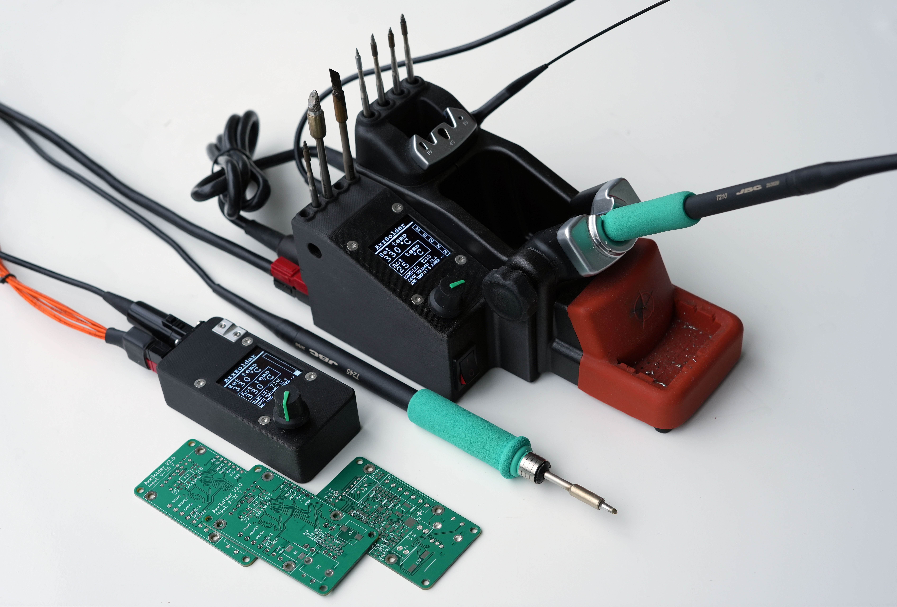

# Questions and support
Please use [Discord](https://discord.gg/AwpHEmsyKj) for build related and general questions.

# Table of Contents
- [AxxSolder Overview](#axxsolder-overview)
- [Questions and support](#questions-and-support)
- [Features](#features)
- [DEMO](#demo)
- [GRAPHING](#graphing)
- [Schematic](#schematic)
- [How AxxSolder works](#how-axxsolder-works)
- [PCB](#pcb)
- [AxxSolder Station](#axxsolder-station)
- [AxxSolder Portable](#axxsolder-portable)
- [Recommended power supply for tip grounding](#recommended-power-supply-for-tip-grounding)
- [Handle identification and connections](#handle-identification-and-connections)
- [Firmware update](#firmware-update)
- [Building the firmware from source](#building-the-firmware-from-source)
- [First start up after build](#first-start-up-after-build)
- [Settings](#settings)
- [Profiles](#profiles)
- [PID control](#pid-control)
- [Cartridge differences](#cartridge-differences)
- [Temperature calibration](#temperature-calibration)
- [Temperature measurement](#temperature-measurement)
- [Current measurement](#current-measurement)
- [Disclaimer](#disclaimer)

# Features
- The tip temperature is set by a rotary encoder. Pressing the encoder toggles heating: while soldering (handle out of the stand) a press stops heating and a second press resumes it, and while the handle is in the stand a press sends AxxSolder straight to Sleep mode (heating off) without waiting out the Standby timeout — press again to wake up.  
- AxxSolder is capable of driving C115, C210 and C245 style cartridges from JBC. With two handle sense inputs AxxSolder can determine if the connected handle is either a NT115, T210 or T245 and adjust max output power accordingly. The max output power is software limited to 130 W for T245, 65 W for T210 and 22 W for NT115 handles.
- When the handle is put into the stand (connected to Stand_sense) AxxSolder goes into "Standby mode". On the portable version an aluminium plate is mounted in the case and allows the AxxSolder to go into Standby mode when the cartridge or handle rests against it. After 10 min in Standby mode AxxSolder goes into "Sleep mode" and heating is completely turned off. This is similar to what JBC calls [Sleep and Hibernation](https://www.jbctools.com/intelligent-heat-management.html).  
- If AxxSolder is left in normal running mode for longer than 30 min, the station automatically goes into sleep mode as a safety feature.  
- Should the temperature ever go higher than 490 °C, overheating is detected and the station goes into sleep mode in order to protect the tip.
- A hardware watchdog resets the MCU if the firmware hangs or the temperature sampling stops (after about 4 s), and the heater is cut if the main loop stalls for more than 0.4 s. After a watchdog reset AxxSolder starts in Sleep mode as usual, shows a "Watchdog reset" popup and does not heat at startup even if "Heat at startup" is enabled. If the firmware crashed (HardFault) before the reset, a FAULT screen with the fault registers is shown once at the next start-up (press a button or wait 5 s) - please include it when reporting a bug.
- At start-up any USB-PD source is detected and the highest possible power is negotiated. AxxSolder limits the soldering iron output power to the negotiated contract power automatically: the nominal contract voltage x the granted current (e.g. 20 V/3.25 A gives 65 W, 15 V/3 A gives 45 W), capped at 100 W; if a USB-C source without a confirmed PD contract is the only supply (bus below 7 V), the output power is limited to the bus voltage x 0.5 A; with the DC jack connected as well (bus at 7 V or more with no PD contract or only a 5 V one) the DC supply is used without a USB limit. Below 8 V input heating stops (also in Standby). The maximum power output is displayed at the top of the power bar graph on the display.
  - One-time NVM change: to get the charger's full current (e.g. 20V/3.25A from a 65 W charger), the firmware sets the REQ_SRC_CURRENT bit in the STUSB4500's non-volatile configuration once, on the first start-up after flashing (also when powered from DC). The rest of the chip configuration is kept: the NVM is read twice and must match, it is verified after writing, and a configuration that is not recognised is never modified. A blank or corrupt NVM (e.g. after a write was interrupted) is restored from ST's factory defaults with the bit set - a custom factory image would only be replaced in that case. If the write keeps failing verification it is retried a limited number of times per boot, and again on the next start-up. The chip only loads its NVM at power-up, so until it has been power cycled the station uses a probe list of fixed USB-PD profiles (20V/5A, 20V/4.5A, 20V/3A, 20V/2.25A, 15V/3A, 12V/3A, 9V/3A - the first one the charger accepts) and the PD information page shows "Replug USB for full power" - disconnect all power and reconnect it once.
  - To build a firmware that never writes the STUSB4500 NVM, set `STUSB_NVM_PROVISION` to 0 in `Core/Inc/stusb4500.h` (or configure with `-DCMAKE_C_FLAGS=-DSTUSB_NVM_PROVISION=0`). The probe list is then always used unless the chip was already provisioned.
- User settings are stored in non-volatile flash and can be configured via a settings menu described in [SETTINGS](#settings).
- The two buttons are used to store temperature presets, e.g. 330 °C and 430 °C. Both preset temperatures are configurable in the settings menu. The stored preset temperature can be updated to the current set temperature by long-pressing the preset button.
- There is a 3.3 V logic level output (GPIO4) that can be configured to go high when the iron is in Run mode, controlling e.g. fume extractor via a MosFET or relay.
- The TFT display used in this project is a 2 inch 320x240 Color TFT display [2.0" 320x240 Color IPS TFT Display](https://www.adafruit.com/product/4311) and shows information about:
  - Set temperature
  - Actual temperature
  - Current power as a bar graph
  - In case of sleep mode, the power bar shows "ZzZzZz"
  - In case of Standby mode, the power bar shows "STANDBY"
  - Input voltage
  - MCU temperature
  - Current detected handle type
  - Current max power output
  - Current power source USB-PD / DC
  - Graph showing set temperature, current temperature and power

# DEMO
[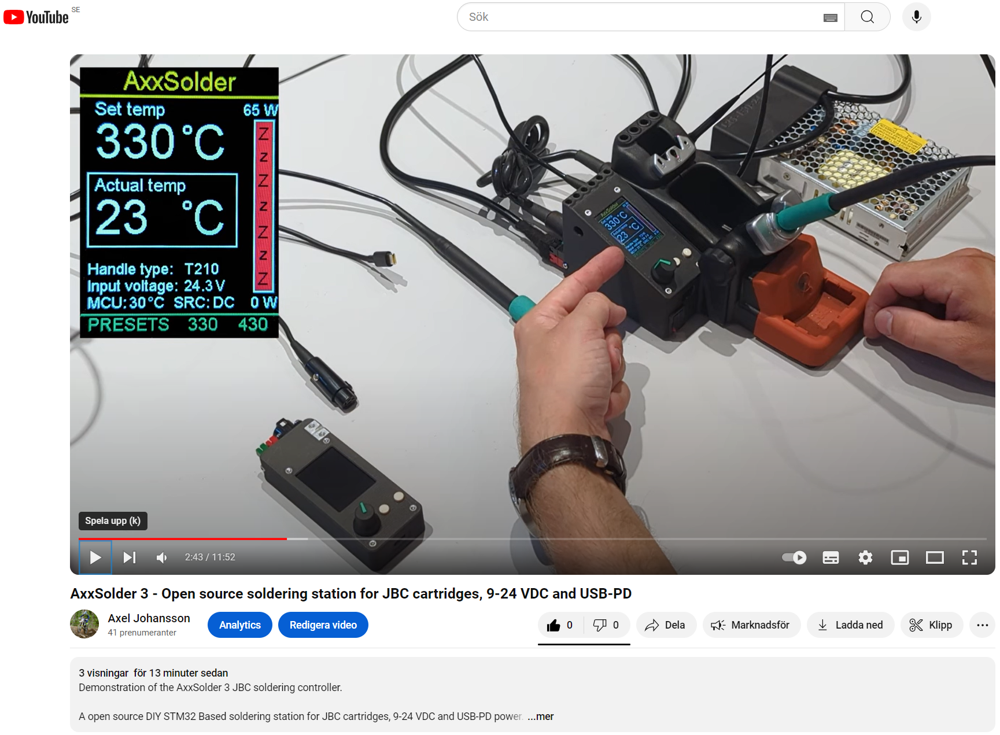](https://www.youtube.com/watch?v=I5uLvEM9wpY)  
[https://www.youtube.com/watch?v=I5uLvEM9wpY](https://www.youtube.com/watch?v=I5uLvEM9wpY)

# GRAPHING
[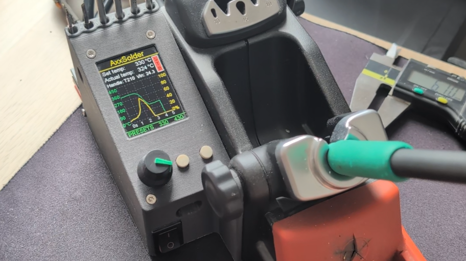](https://www.youtube.com/watch?v=BTZFAHj0sKs)  
[https://www.youtube.com/watch?v=BTZFAHj0sKs](https://www.youtube.com/watch?v=BTZFAHj0sKs)

# Schematic
The schematic for AxxSolder is shown below. Both station and portable versions use the same PCB and software. The MCU is a [STM32G431CBT6](https://www.st.com/en/microcontrollers-microprocessors/stm32g431cb.html). 
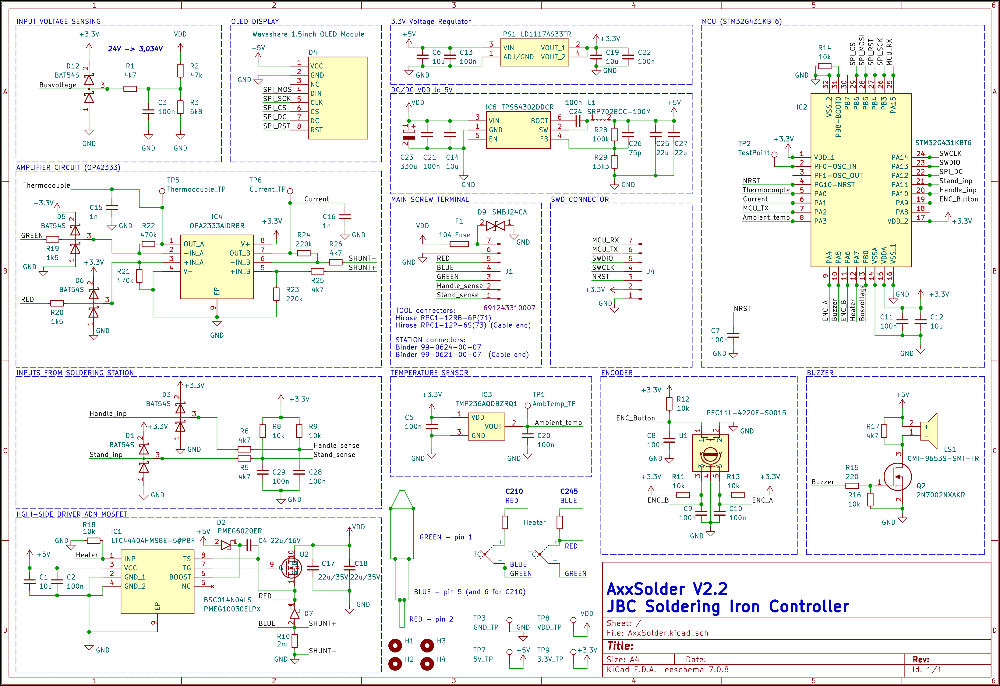

# How AxxSolder works
All JBC cartridges contain a resistive heater element and a thermocouple. To determine how they are arranged internally, cross sections were made of a C210 and a C245 (see [Cartridge differences](#cartridge-differences)). These show that the heater and the thermocouple are connected in series and share the same wires out to the handle, so there is no separate sense pair. This means the station cannot heat and measure at the same time - the thermocouple output is only a few millivolts and is completely covered by the switching noise from the heater.

AxxSolder handles this by alternating between heating and measuring. Forty times a second a timer interrupt turns the heater off, waits 0.5 ms for the signal to settle, and triggers the ADC. The heater is switched back on as soon as the conversion is finished. The measurement window is short compared to the 25 ms between measurements, so very little heating power is lost and the control loop still gets a clean reading every cycle. On a scope you can see the PWM stop, a flat section appear, the ADC sample taken in the middle of it, and the switching resume. This is shown in detail under [Temperature measurement](#temperature-measurement).

## The amplifier
The thermocouple signal is amplified by one half of an **OPA2387** in a difference amplifier configuration, with 1.5 kΩ input resistors and 360 kΩ feedback resistors giving a gain of 240. Low-leakage BAV199 diodes clamp the input between ground and 3.3 V and protect the op-amp against transients from the heater switching. The OPA2387 is a zero-drift type, which matters at this gain: with an ordinary op-amp, the offset drift alone would add tens of degrees of error as the board heats up from the DC/DC converter next to it. The OPA2387 drifts around 0.01 µV/°C. The amplified value is converted to degrees by a second order polynomial fitted for each cartridge family against a Hakko FG-100 tip thermometer, and corrected further by up to six user calibration points, see [Temperature calibration](#temperature-calibration). Two sense pins in the handle connector tell the firmware which handle is connected and therefore which polynomial to use.

## The power stage
The heater is switched by a single **BSC014N04LS**, a 40 V, 1.4 mΩ N-channel MOSFET, on the high side: the drain sits on the supply rail and the source feeds the cartridge, which returns through a 5 mΩ shunt to ground. This is what makes the measurement possible. With the MOSFET off, no current flows and the whole cartridge is pulled to within a few millivolts of ground through the heater element, so the thermocouple sits at a common mode voltage the difference amplifier can work with. A low-side switch would leave the cartridge floating up to the supply rail whenever the MOSFET was off, which is exactly the moment the measurement has to be taken.

A high-side N-channel MOSFET needs a gate voltage above the supply rail, and this is provided by an **LTC4440A-5** bootstrap gate driver. It charges a capacitor from the 7.5 V rail through a Schottky diode while the MOSFET is off, and uses that charge to hold the gate about 7 V above the source when it turns on, with 1.1 A of peak pull-up current so the MOSFET crosses its linear region quickly. Conduction losses are low enough that no heatsink is needed anywhere on the board. The PWM frequency is 20 kHz, chosen to be just above the audible range so the bulk capacitors and the handle cable stay quiet.

## The microcontroller
The MCU is an **STM32G431CBT6**, a 170 MHz Cortex-M4F running from its internal RC oscillator. It is intended for motor control, which suits this application well: fast advanced-timer PWM, two independent 12-bit ADCs and enough DMA to keep sampling away from the CPU. ADC1 runs a circular DMA buffer with three interleaved channels - thermocouple, bus voltage and MCU temperature - which are averaged in software. ADC2 is used for the heater current shunt, so a current measurement can be started from the PWM timer's own interrupt without disturbing the temperature sampling, see [Current measurement](#current-measurement).

## Temperature regulation
Temperature is regulated by a PID controller computing a new output every 25 ms, with parameters stored per cartridge profile. The output sets the heater duty cycle and is bounded between zero and full power, and that bound is what makes a plain PID unsuitable here. A heat-up from room temperature is a 300 °C error, and the duty cycle stays at its maximum for the whole ramp regardless of what the controller asks for - the actuator is saturated. An unmodified integral term keeps accumulating error throughout, even though the additional output has no effect on the plant. This is integral windup. By the time the tip reaches the setpoint, the integral term holds a large value that can only be removed by accumulating error of the opposite sign, so the controller continues driving the heater past the setpoint until it has unwound. A soldering iron is also an asymmetric plant: heating is active, but cooling is only passive loss to the surroundings, so an overshoot takes considerably longer to recover from than an undershoot. Several anti-windup measures are therefore used. Conditional integration blocks the integral term entirely while the error is above 75 °C, so the ramp is driven by P and D alone. Clamping holds integration for a cycle if the update would push the output past its limits while the error is still driving in the same direction, and the accumulated term has its own limit separate from the output limit. The integral gain is raised for negative errors so that an overshoot is unwound faster than it was built up, and the derivative term acts on the measured temperature rather than the error to avoid a derivative kick when the setpoint is changed. A heat-up to 330 °C takes about 1.5 seconds on a C210-002 with very little overshoot, tuned using the firmware's serial stream of setpoint, temperature and the individual P, I and D contributions. The tuning parameters are listed under [PID control](#pid-control).

# PCB
The PCBs are designed in KiCad and manufactured by [PCBWay](https://www.pcbway.com/). PCBWay has sponsored this project with PCBs and stencils. The support and quality from PCBWay is great and therefore PCBWay is the recommended PCB supplier for this project. As some components have a rather fine pitch (0.5 mm, as in the LQFP-48 package of the STM32) and some packages are "no lead" with a bottom thermal pad e.g. the WSON-8 package of the OPA2387 it is recommended to use a stencil to apply solder paste and then reflow the board using either a reflow oven or hot-plate. The boards on the image below were reflowed on a hot-plate (a homemade AxxPlate). A microscope is also recommended and helpful during assembly.
Printed Circuit Boards with assembled components are shown in the image below.
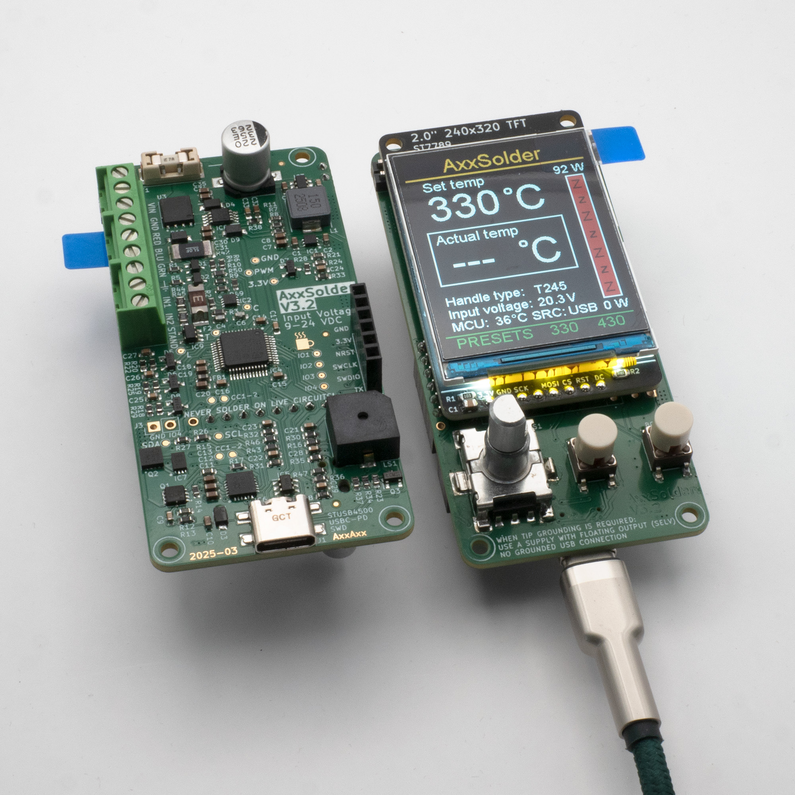
A 3D view (front and back) of the AxxSolder PCB is generated with KiCad and shown below. 
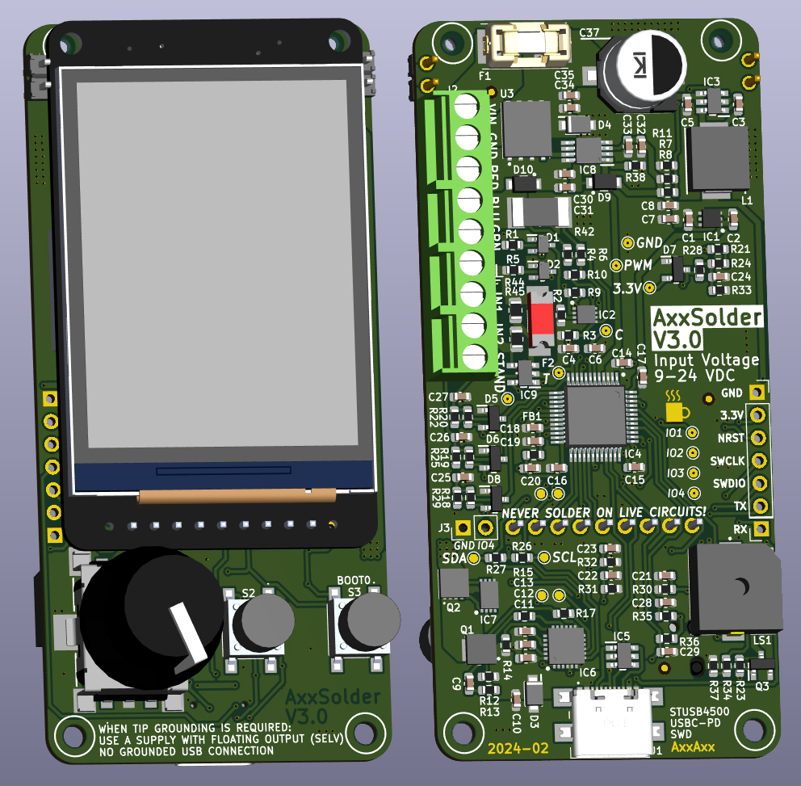

# AxxSolder Station
The preferred setup is to pair AxxSolder with the [JBC ADS stand](https://www.jbctools.com/ad-sf-stand-for-t210-t245-handles-product-2018.html). This makes a very nice, compact and powerful soldering station. The JBC ADS stand is paired with a custom 3D printed enclosure for AxxSolder and the PCB is mounted with two mounting brackets. All 3D printed parts are available under [/CAD](https://github.com/AxxAxx/AxxSolder/tree/main/CAD). 
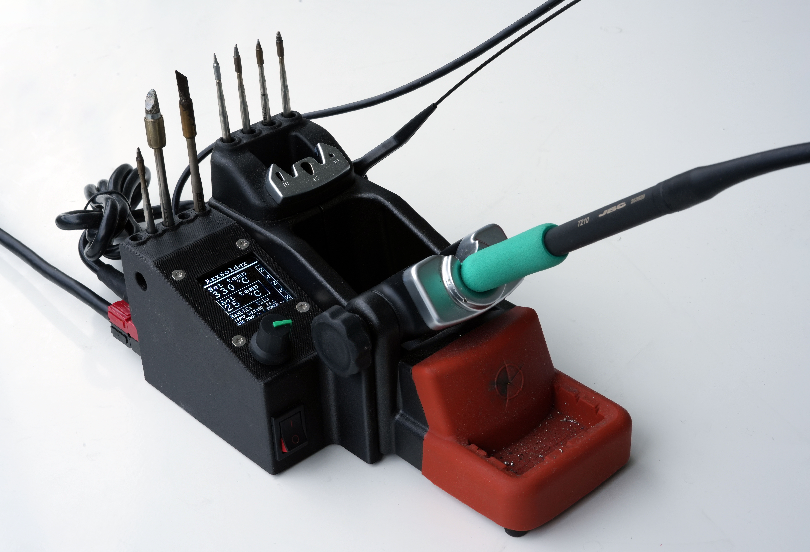  
The JBC ADS stand comes with a silicone cable fitted with two Binder 99-0621-00-07 connectors. In order to use this cable a Binder 99-0624-00-07 is mounted into the AxxSolder enclosure and wired as shown in the image below:  
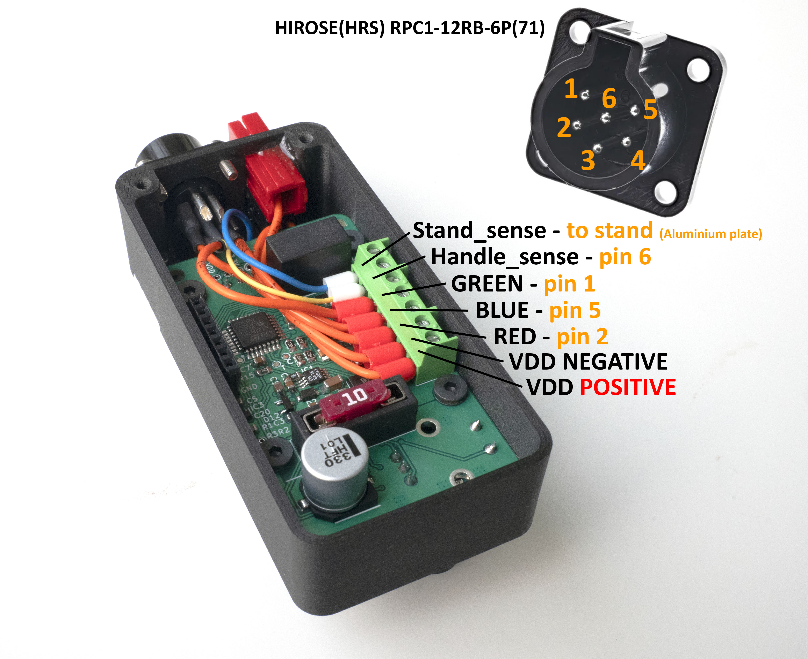  
By default, the stand separates the two signals coming from the "tool rest position" and the "tip change position" and does NOT have two separate connections for tip sensing 1 and 2 as is needed if NT115, T210 and T245 handles should all be automatically detected. Therefore, a modification is done to the PCB inside the JBC ADS stand in order to combine the "tool rest position" and the "tip change position" sense into one connection and separate the two tip sense connections. This is shown in the image above. The stand is held together with two PH0 screws from the side.  
NOTE: This modification of the stand is only needed if you want to be able to use NT115, T210 and T245 with your JBC ADS stand. If you know that you will only be using T210 and/or T245 you can change the user setting: Detect NT115 to "NO" in the settings in order for T210 and T245 to be automatically detected with an unmodified JBC ADS stand.
 
The JBC ADS stand is an expensive piece and thankfully there are many alternatives online for those who want to save some money. The community on the AxxSolder Discord channel has created many enclosures for alternative stands such as the GEEBOON SDC02, and some of the AiXun stands. Some of the models are available under [Alternative stands](https://github.com/AxxAxx/AxxSolder/tree/main/CAD/Alternative_enclosures_and_designs).

# AxxSolder Portable
It is often nice to have a compact and portable soldering iron controller for when you are away from your comfortable desk. A neat powerful package with the same capabilities as your main soldering station. This is why AxxSolder Portable was designed. The only difference between AxxSolder station and Portable is the enclosure.  
As AxxSolder accepts an input of 9-24 V it is compatible with a range of battery options. The author usually uses a battery pack consisting of 12 Samsung INR18650 35E in a 3S4P configuration which works very well.  
The portable version has an aluminium tab on the enclosure connected to the same input on the PCB as the "handle rest" on the station version. This allows the user to rest the iron onto the aluminium tab and automatically enter sleep mode.   
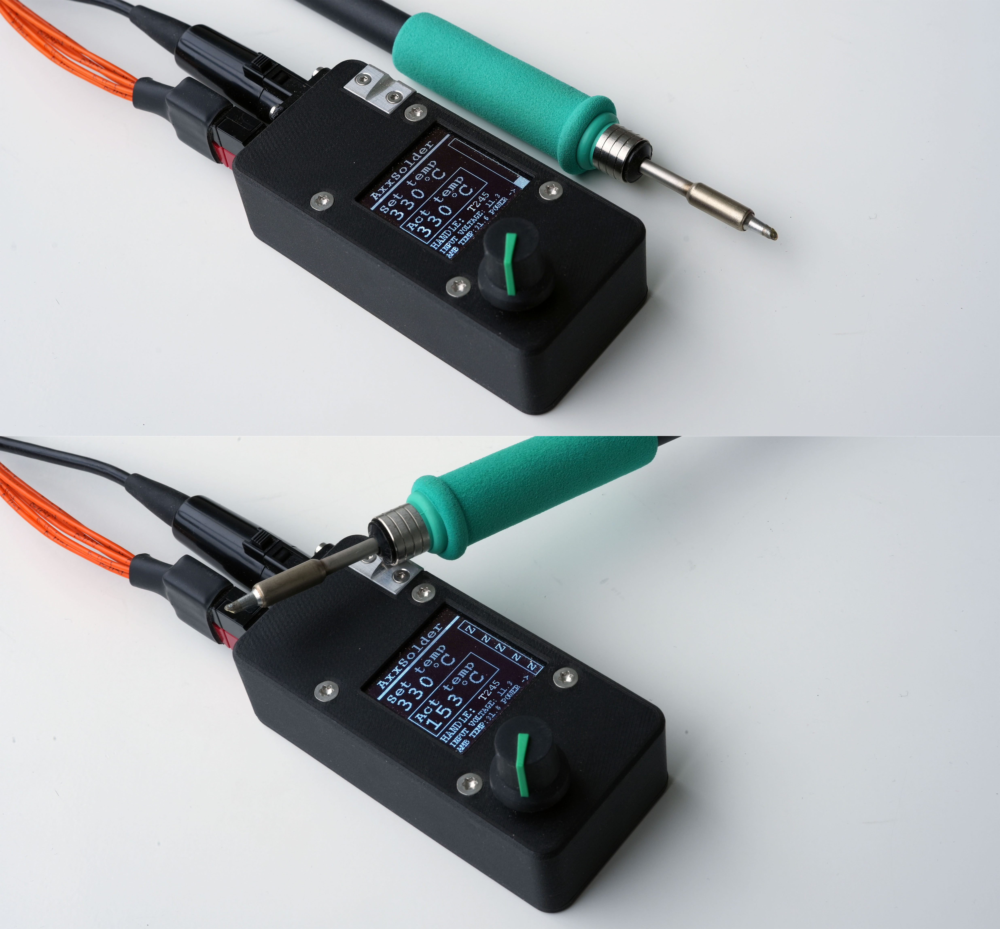
The connections from the handle to the PCB through the Hirose RPC1-12RB-6P(71) connector are shown below. The Stand_sense in the portable version is connected to the aluminium plate which tells the AxxSolder to go into sleep mode when in contact with the soldering iron.  
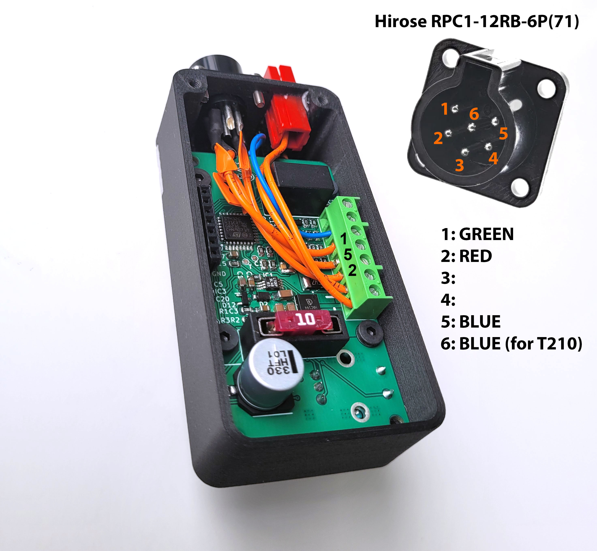

# Recommended power supply for tip grounding
⚠️ WARNING: Do NOT use power supplies where the DC output is referenced to mains earth (PELV). Due to the internal construction of C245 tips, using a PELV supply can cause a short circuit through the soldering tip. This applies to both DC barrel jack and USB-C power.

In order to be able to ground the tip of the soldering iron the user MUST use a power supply with a floating output (SELV) and connect protective earth to the ground terminal on AxxSolder. No device other than AxxSolder should share this DC supply. A well-suited power supply with floating output (SELV) is the Meanwell LRS-150-24. It is rated for 156 W at 24 V. By using this kind of power supply, AxxSolder can be connected directly to its DC output and to mains earth thus keeping the tip of the soldering iron at earth ground potential. There is a 1A fuse after the earth terminal in parallel with a 1M resistor on the AxxSolder.  
A printable cover protecting the terminals of the LRS-150-24 can be found under [/CAD](https://github.com/AxxAxx/AxxSolder/tree/main/CAD).  

Other suitable power supplies are the Meanwell XLG-150-24 and the GSM160A24-R7B, which have a slightly different form factor, do not have the switching noise of the LRS-150-24 and are fully enclosed.

## USB-C power
Most USB-C chargers have floating outputs and work fine. However, some chargers connect the USB-C shell to mains earth — these must not be used as they create the same problem as a PELV DC supply.
  
# Handle identification and connections
In order for AxxSolder to know which type of handle (NT115, T210, T245) is attached, specific pins inside the handle connector must be connected (bridged with a jumper wire). By default, the original JBC handle T245 has NO bridged pins while inside the connector of the original JBC T210 pins 5 and 6 are bridged with a jumper wire. The original NT115 handle from JBC has a different connector and must be modified accordingly. All the necessary connections are shown in the image below.  
When powering on AxxSolder for the first time after doing these connections inside the handle connector it is wise to attach a handle without its cartridge and ensure that AxxSolder detects and shows the correct handle type on the display.  
Failing to detect the handle type may cause permanent damage to the cartridge as the temperature calibration and max allowed power will be wrong.  
❗WARNING❗ It has been discovered that some JBC clones have different pins bridged by the manufacturer. For example: Some AiXun T210 handles have pins 1 and 6 bridged, instead of pins 5 and 6 as AxxSolder requires for T210 handles. It is however easy to open up the connector and do the required pin connection.      
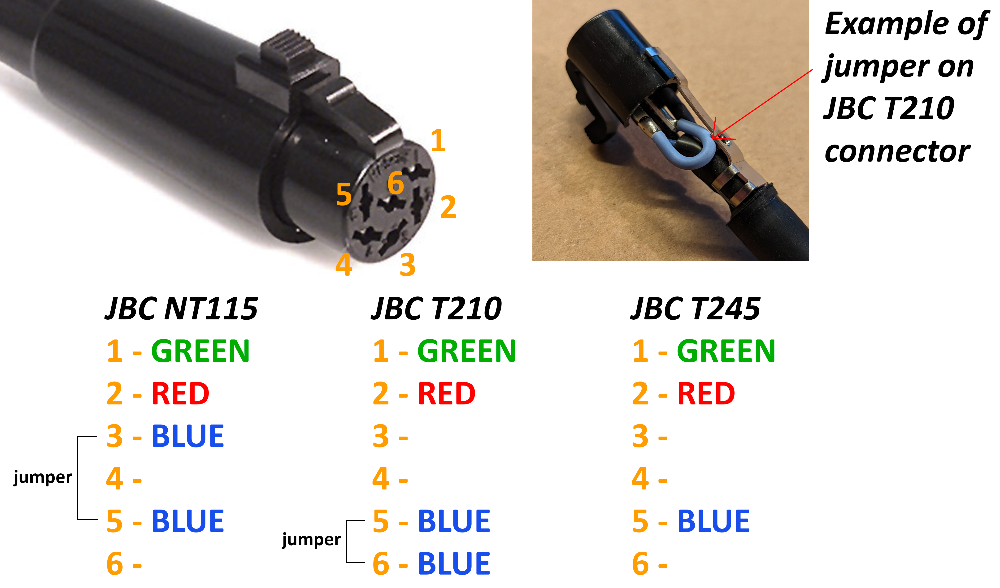

# Firmware update
Flashing or updating the firmware on the STM32 MCU can be done in two ways, by using a SWD programmer or directly via USB. 

## SWD programmer

These come in a variety of models and are available from several different places online. In the below example a [STLINK-V3MINIE](https://www.st.com/en/development-tools/stlink-v3minie.html) SWD programmer is used. The MCU is programmed by the following steps:
1. Disconnect any soldering iron handles from AxxSolder during the firmware update process.
2. Download the latest `AxxSolder.bin` file from [Releases](https://github.com/AxxAxx/AxxSolder/releases)
3. Connect your SWD programmer to the target MCU with GND, 3.3V, (N)RST, SWCLK and SWDIO (see table below)
4. If your SWD programmer *cannot* supply 3.3V it is necessary to power the AxxSolder from an external supply.
5. Start your programming software. [STM32CubeProgrammer](https://www.st.com/en/development-tools/stm32cubeprog.html) is used in this example.
6. Connect to the target by selecting *ST-LINK* and click on *Connect*
7. Load the latest `AxxSolder.bin` downloaded in *Step 2* by clicking *Open file* and select the downloaded binary file.
8. Write the firmware to the MCU by clicking *Download*.
9. If you get the message *File download complete* everything succeeded: the SWD programmer can be disconnected, and after AxxSolder has been power cycled once it should boot.
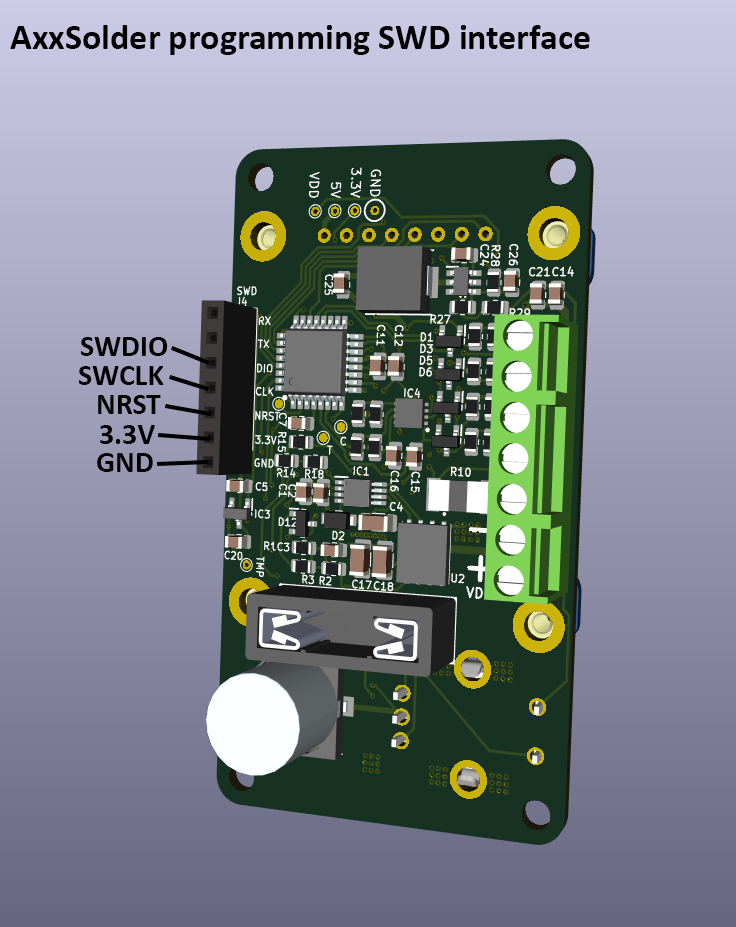

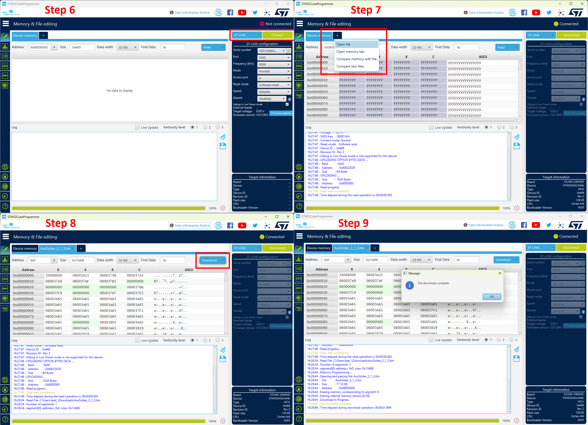

| STLINK-V3MINIE CN2 | AxxSolder J4 |
|----------|--------------|
| GND      | GND          |
| VCC      | 3.3V         |
| RST      | (N)RST       |
| CLK      | SWCLK        |
| TMS      | SWDIO        |

## USB (DFU mode)

1. Disconnect any soldering iron handles from _AxxSolder_ during the firmware update process.
2. Download the latest `AxxSolder.bin` file from [Releases](https://github.com/AxxAxx/AxxSolder/releases)
3. Connect the AxxSolder via USB to a computer that runs [STM32CubeProgrammer](https://www.st.com/en/development-tools/stm32cubeprog.html) - hold down the rightmost button (S3) while plugging in the USB connector in order to enter DFU mode (your safest bet is to use a USB-A to USB-C cable, because in some cases the PD negotiation may mess things up - a USB-C to C cable that is known to **not** support PD negotiation (CC lines unconnected) can alternatively be used).
4. Connect to the target by selecting *USB* and click on *Connect*
5. Load the latest `AxxSolder.bin` downloaded in *Step 2* by clicking *Open file* and select the downloaded binary file.
6. Write the firmware to the MCU by clicking *Download*.
7. If you get the message *File download complete* everything succeeded and the USB cable can be disconnected.
8. Power cycle once and AxxSolder should boot.

# Building the firmware from source
The firmware is built with CMake and the ARM GCC toolchain (`gcc-arm-none-eabi`) from the `AxxSolder_firmware` directory:

```sh
cd AxxSolder_firmware
cmake -S . -B build
cmake --build build -j
```
The build produces `AxxSolder.elf`, `AxxSolder.hex` and `AxxSolder.bin` in the `build` directory.
The following CMake cache options can be used to configure the build:

| Option | Values | Default |
|--------|--------|---------|
| `LCD_CONTROLLER` | ST7789, ST7735 | ST7789 |
| `LCD_SIZE` | 240X320, 240X280, 240X240, 135X240, 160X128, 128X128, 160X80 | 240X320 |
| `LCD_ROTATION` | 0-3 | 2 |
| `STORAGE_PROFILES` | FLASH, EEPROM, SDCARD | FLASH |
| `STORAGE_SETTINGS` | FLASH, EEPROM, SDCARD | FLASH |

For example: `cmake -S . -B build -DLCD_CONTROLLER=ST7735 -DLCD_SIZE=160X128`.

For a reproducible build without installing the toolchain locally, a `Containerfile` is provided in `AxxSolder_firmware` and can be built with e.g. podman or docker:

```sh
cd AxxSolder_firmware
podman build -t axxsolder -f Containerfile .
```
The container runs the same CMake build during the image build and the resulting binaries end up under `/app/build` inside the image.

# First start up after build
The first start-up after you have built your AxxSolder can be intense. Double check all solder connections under a loupe/microscope before applying power. The OPA2387, LTC4440 and STM32G431 in particular are all small packages with tight pad spacing and can have solder bridges. Do also double check the connections to the soldering iron/stand which are shown in this document under [AxxSolder Station](#axxsolder-station) and [AxxSolder Portable](#axxsolder-portable).  
The first thing to do after you have double-checked everything is to follow the steps under [Firmware update](#firmware-update). It is wise to do the first programming of AxxSolder without any handle piece and with only 3.3 V, not VDD. After the programming is done you can power up AxxSolder again with 3.3 V, and this time you can also attach your handle. This allows you to test that your handle type is detected correctly (the detected handle type NT115/T210/T245 is shown in the display). The Standby feature can also be tested by touching the stand (STAND Input).  
If the handle is detected correctly, the Standby function works and the display works, proceed to test the 7.35V DC/DC. This is done by once again disconnecting the handle, but this time apply current-limited 9-24 V VDD. 100 mA at 24 V is enough to check that the display starts and that you can measure the three bus voltages; 3.3 V, 7.35 V and VDD. If the bus voltages look good and the display shows the main screen you are ready to apply full VDD power and attach the soldering handle.  
If you are not 110% sure about your soldering/connections it is wise to be on the safe side and keep your soldering tip in a water bath in order to prevent it from over-heating in an uncontrolled manner. During the development of AxxSolder this method was used and saved a few of those expensive JBC cartridges.

# Settings
To access the user settings the user holds down the encoder button at start-up or long-presses the encoder button. A SETTINGS text is then presented and the button can be released. While in the settings there are several parameters available grouped together under MODE, PRESETS, PROFILES, DISPLAY, SOUND and SYSTEM.
| Group | Setting | Description  | Unit | Default |
|----|---------|------|----------------------|----------------------|
|MODE|Startup Temp °C|Default temperature selected after boot|°C|330|
|MODE|Temp Offset °C|Temperature offset applied to measured temperature|°C|0|
|MODE|Standby Temp °C|Temperature to go to after handle is set in stand|°C|150|
|MODE|Standby delay [s]|Time between putting the handle in the stand to going into standby mode|seconds|0|
|MODE|Standby Time [min]|Time for which standby temperature is held before cooling down|minutes|10|
|MODE|Sleep Time [min]|Time that the iron can be ON before cooling down (safety feature)|minutes|30|
|SOUND|Buzzer Enabled|Enable or Disable the buzzer|YES/NO|YES|
|PRESETS|Preset Temp 1 °C|Preset temperature for button 1|°C|330|
|PRESETS|Preset Temp 2 °C|Preset temperature for button 2|°C|430|
|MODE|GPIO4 ON at run|Enable 3.3V output on GPIO4 when the iron is in run mode|YES/NO|NO|
|DISPLAY|Screen Rotation|Rotate the screen|0°, 90°, 180°, 270°|0°|
|MODE|Momentary stand|Use the stand as a momentary switch to go between modes (useful on AxxSolder Portable)|YES/NO|NO|
|MODE|I Measurement|Measure the heater current|YES/NO|YES|
|SOUND|Startup Beep|Beep after startup|YES/NO|YES|
|DISPLAY|Temperature unit|Show temperatures in Celsius or Fahrenheit|°F/°C|°C|
|MODE|Serial DEBUG|Print debug over serial|YES/NO|NO|
|DISPLAY|Disp Temp. filter|Moving average filter length|Length|5|
|MODE|Start at prev. temp|Startup temp is the previously used temp|YES/NO|NO|
|MODE|3-button mode|Use 3-button mode|YES/NO|NO|
|SOUND|Beep at set temp|Beep at set temp|YES/NO|YES|
|SOUND|Beep tone|Beep tone|0,1,2,3|0|
|DISPLAY|Show power|Current power under the bar graph is displayed in this unit|W/%|W|
|MODE|Detect NT115|Detect NT115 handles or not. Useful to turn OFF for unmodified JBC ADS stands|YES/NO|YES|
|DISPLAY|Graph screen|Replace the main screen with a full-screen temperature graph. Mutually exclusive with Debug screen — enabling one turns the other off|YES/NO|NO|
|DISPLAY|Debug screen|Replace the main screen with a full-screen debug view showing all main screen values plus real/previous state, stand and handle sense inputs, filtered+instant tip temp, heater/leak currents, raw ADC, PD limit, standby countdown, uptime and FW/HW version. Mutually exclusive with Graph screen — enabling one turns the other off|YES/NO|NO|
|DISPLAY|PD information|Action item (not a toggle): opens a full-screen page with the boot USB-PD snapshot — STUSB4500 detected, USB-C attach status, negotiated contract (voltage, current, power limit), negotiation mode (auto = full current, or probe list with the NVM pending a power cycle, disabled or in error, plus a "Replug USB for full power" hint when pending), RDO details and the offered sink PDOs — plus live bus voltage. Click the encoder to return to the menu. The charger's source PDO list cannot be read from the STUSB4500, so it is not shown|N/A|N/A|
|MODE|Delta T detect|Stop heating if the tip temperature jumps by more than 50 °C and is still off 50 ms later (thermocouple fault): AxxSolder goes to sleep and shows "TC delta fault". Shorter glitches are ignored|YES/NO|YES|
|MODE|Profile on tip chg.|Show popup when changing tip asking for tip preset|YES/NO|NO|
|MODE|Change Enc. dir.|Changes the direction of the encoder|YES/NO|NO|
|MODE|Enc. step|Changes amount of steps per encoder tick|1,2,5,10|2|
|MODE|Heat at startup|If enabled AxxSolder starts to heat at startup (not after a watchdog reset)|YES/NO|NO|
|SYSTEM|-Load Default-|Load default parameters and tip profiles (kept only with -Save and Reboot-)|N/A|N/A|
|SYSTEM|-Save and Reboot-|Exit and Save|N/A|N/A|
|SYSTEM|-Exit no Save-|Exit without Save|N/A|N/A|

Note: per-tip power limits and temperature calibration have moved from the settings menu into [Profiles](#profiles) (Profile editor → "Power Lim" and "Cal 100" … "Cal 450").

# Profiles
Under the setting menu Profiles the user can select, adjust and create new profiles for the supported cartridge types. Name, PID parameters, calibration data and power limits can be set individually for each profile and are saved to flash. A more detailed instruction can be found under [PROFILES.md](./docs/PROFILES.md)
# PID control
The thermal mass and heat convection differs between different tip designs. Therefore the PID parameters should in theory be adjusted to each different cartridge. This can be done by utilizing custom profiles. The default PID parameters for the supported cartridges have however shown good thermal performance and are a good baseline.

The defaults are stored as built-in "Default" tip profiles - one per cartridge type - and can be overridden per profile in the profile editor:

| Handle type | Kp | Ki | Kd | Max I | Max power |
|-------------|----|----|----|-------|-----------|
| NT115       | 5  | 2  | 0.3| 300   | 22 W      |
| T210        | 7  | 4  | 0.3| 300   | 65 W      |
| T245        | 8  | 2  | 0.5| 300   | 130 W     |
| No name     | -  | -  | -  | -     | 150 W     |

```c
/* General PID parameters */
#define PID_MAX_OUTPUT          500
#define PID_UPDATE_INTERVAL     25
#define PID_ADD_I_MIN_ERROR     75
```
The PID parameters are adjusted to achieve a fast response with minimum overshoot and oscillation. The below image is showing the set temperature, actual temperature response as well as the P, I and D contributions during a heat-up cycle from 25 °C to 330 °C. This heat-up sequence takes ~1.5 seconds for a C210-002 cartridge.  

The below screenshot is from the serial terminal software [AxxTerm](https://github.com/AxxAxx/AxxTerm)  

 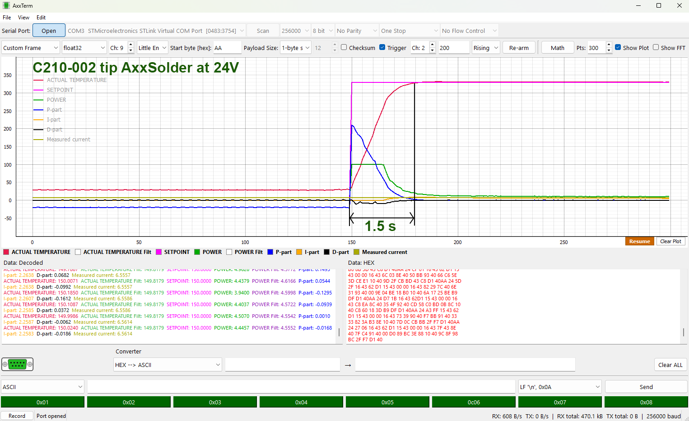

# Cartridge differences
All JBC cartridges contain a thermocouple element to read the tip temperature and a resistive heater element. The configuration of thermocouple and heater element differ slightly between cartridge models. In order to determine the internal configuration of the cartridges two cross sections were made. These show clearly how the C210 and C245 cartridges are constructed internally. The images can be seen here: [https://www.eevblog.com/forum/projects/axxsolder-jbc-soldering-controller](https://www.eevblog.com/forum/projects/axxsolder-jbc-soldering-controller/msg5124267/#msg5124267).  
As the thermocouple output also differs (see my measurements under [Temperature calibration](#temperature-calibration)) the correct handle/cartridge type has to be set. This is done automatically by the inputs "Handle_sense_1" and "Handle_sense_2". This can be done thanks to the design of the handle connector. For the JBC T210 handle, pins 5 and 6 are connected internally in the connector, and for NT115, pins 3 and 5 should be connected. This allows AxxSolder to sense which handle is connected and assign correct thermocouple correction, PID parameters and max output power.
 
# Temperature calibration
The voltage from the thermocouple embedded inside the cartridge is amplified by an OPA2387 operational amplifier and then read by the ADC of the MCU. To correlate the measured ADC value to the cartridge temperature experiments were done. A constant power was applied to the heating element of the cartridge and the ADC value was read as well as the actual tip temperature. The tip temperature was measured by a "Soldering Tip Thermocouple" used in e.g. the Hakko FG-100.   
The measured data was recorded and plotted for the C115, C210 and C245 cartridges. The specific cartridges used were the C115112, C210-007 and C245-945. The measured data were fitted to polynomial equations:  
$Temp_{C115}[deg] =  5.10e^{-5} * ADC^2 + 0.42* ADC + 20.15$  
$Temp_{C210}[deg] =  4.22e^{-6} * ADC^2 + 0.32* ADC + 20.97$  
$Temp_{C245}[deg] = -4.73e^{-7} * ADC^2 + 0.12* ADC + 23.78$  
These are then used in the software to retrieve correct tip temperatures.
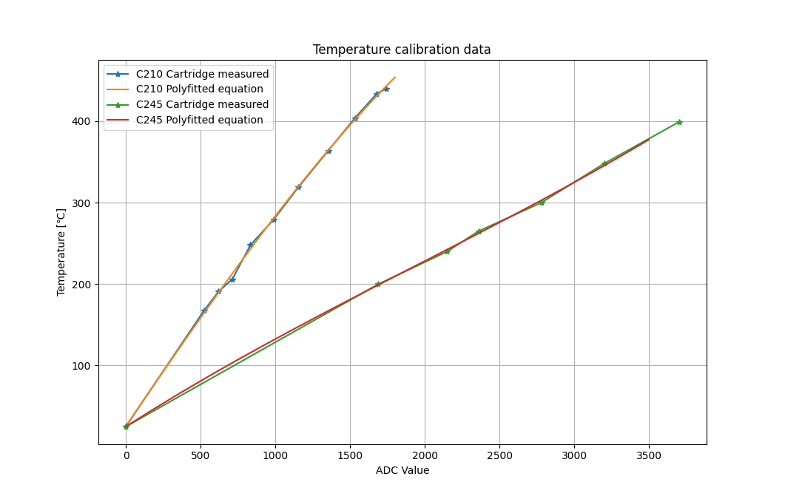

The user can adjust the temperature calibration at 6 points in order to compensate for variations in the cartridge thermocouple. The calibration points are stored per tip profile and are edited in the profile editor ("Cal 100" … "Cal 450"), see [Profiles](#profiles).  
To calibrate temperature(s):
- Make sure that the calibration values in the active tip profile are at their default nominal values.
- Set AxxSolder to the temperature that you want to calibrate, for example 300 °C.
- When AxxSolder stabilizes around the setpoint, measure the actual tip temperature by using a soldering tip thermocouple, for example the HAKKO FG-100B.
- Input the actual measured temperature, let's say 302 °C, into the 300 °C calibration field of the active profile ("Cal 300" = 302).
  
AxxSolder will then use this calibration point and correct the temperature accordingly. It will do so linearly between all calibration points.

# Temperature measurement
As the thermocouple and heater element are connected in series inside the JBC cartridges and the thermocouple voltage is measured over the same pins as the heating element we have to be careful about when to take the temperature measurement. In order to not disturb the thermocouple measurement with heater element switching, the switching is turned off for 0.5 ms just before the temperature measurement is taken. The 0.5 ms delay ensures that the switching is turned off and the thermocouple signal is stabilized around a stable voltage.  
The measured signal over the thermocouple is clamped to 3.3V with a BAV199 low-leakage switching diode in order to protect the op-amp OPA2387. The voltage measurement is taken by the internal ADC in DMA mode with a circular buffer. The buffer holds several measurements which are averaged and filtered in software.  
The yellow curve in the image below (Channel 1) shows the PWM signal driving the gate of the MOSFET.  
The green curve shows the amplified voltage between GREEN and RED wire in the JBC handle at 330 °C and 10% power, and the cyan curve at 100 °C and 100% power (the tip cooled down trying to heat up).  
The blue pulse indicates the wait time of 0.5 ms and the magenta pulse is where the ADC is sampled.

# Current measurement
The current is sampled four times per second by a 30 us current pulse through the heater. This is done both to check if there is a functioning tip in the handle (otherwise the display shows "---" at current temp) and to be able to calculate the power drawn by the heater. Knowing the heater current, the bus voltage and the pulse duty cycle, the actual power can be calculated. To measure the current the gate to the MOSFET is turned on, 10 us later the voltage over the current shunt is sampled by the ADC and the result is converted. This is shown in the image below.

# Disclaimer
AxxSolder is an open source project and has absolutely no warranty, or guarantees on functionality or reliability! The authors of this project accept absolutely no liability for any harm or loss resulting from its use. That said, have fun. :)

